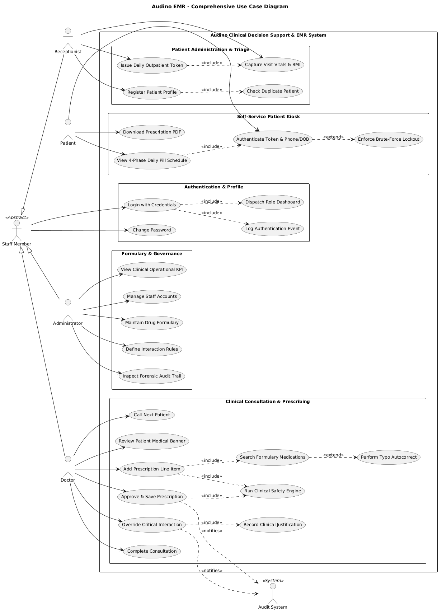
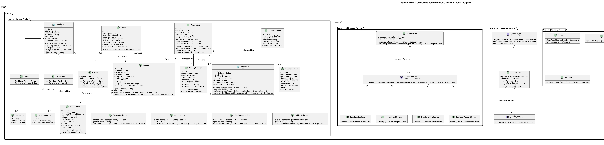
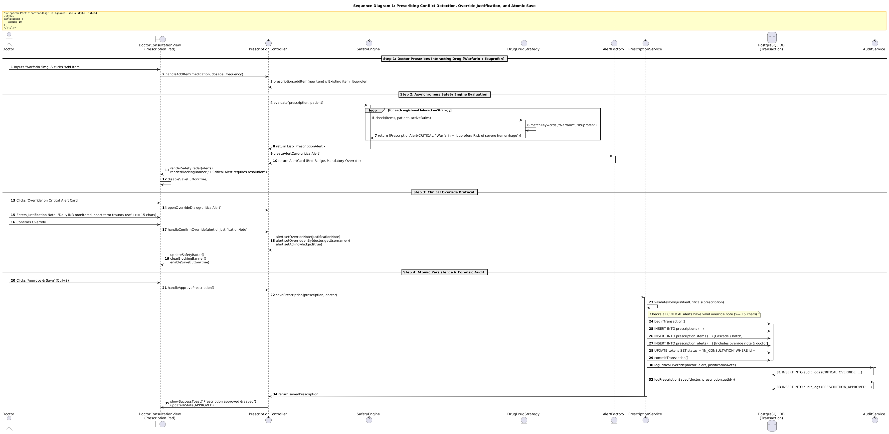
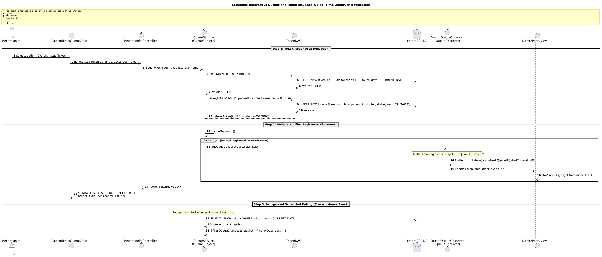
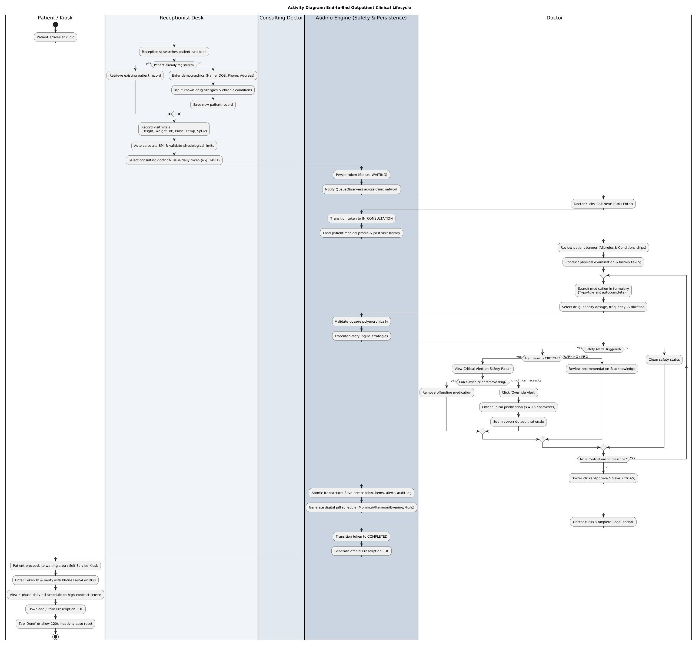
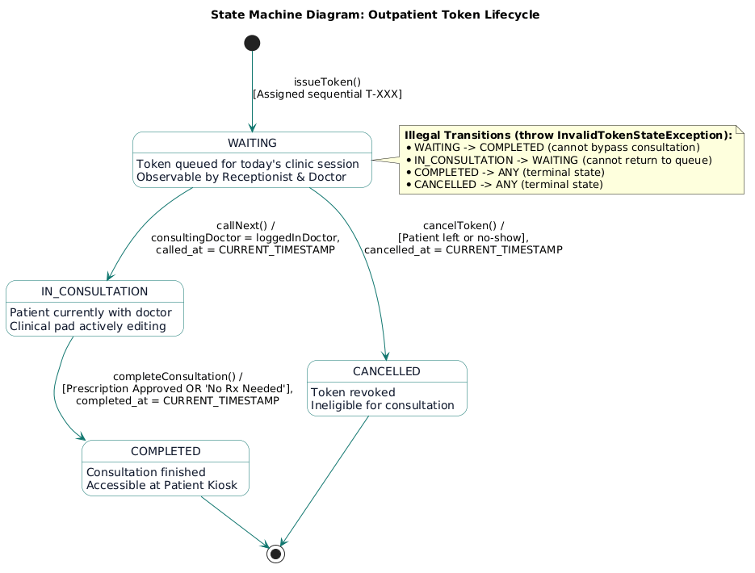
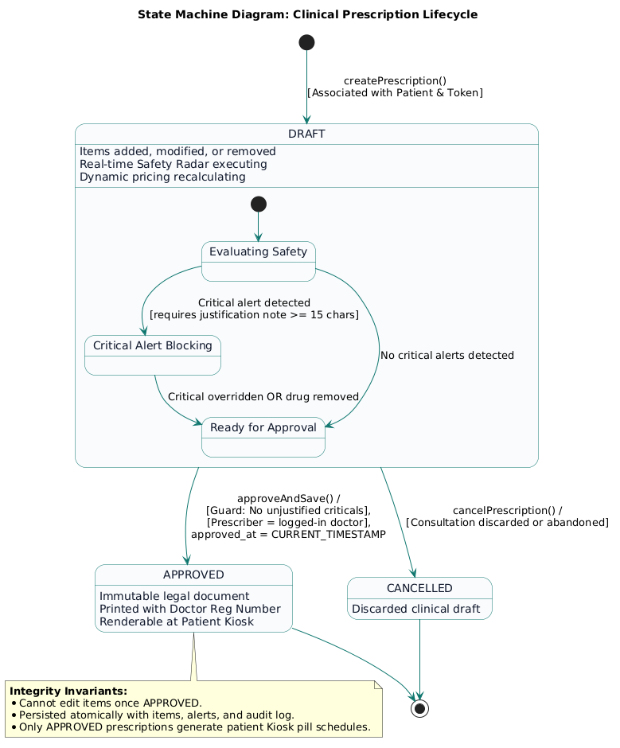
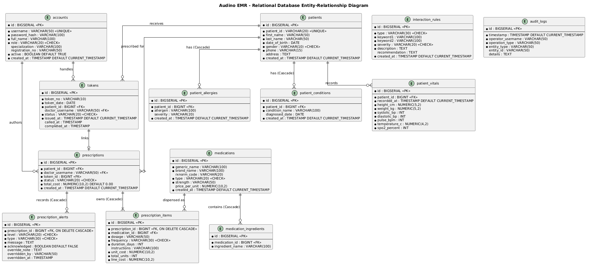
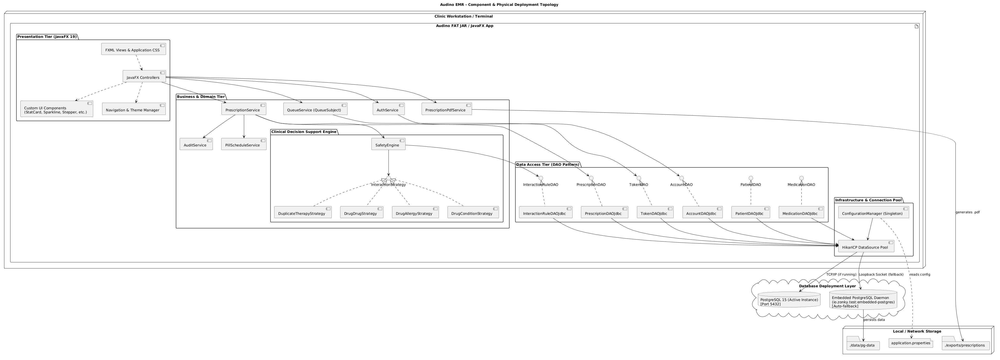

# Audino EMR: Object-Oriented Methodology (OOM) Concepts Map

**Document Version:** 2.0.0  
**Target Evaluation Date:** 19-Nov-2026  
**Evaluation Rubrics:** Object-Oriented Methodology (OOM) & Software Engineering (SE)  
**System Name:** Audino: Intelligent Clinical Decision Support & EMR System  

---

## 1. Executive Summary

Audino is designed around object-oriented principles to solve a real healthcare problem: **preventing Adverse Drug Events (ADEs)**, such as a doctor prescribing Ibuprofen to a patient already on Warfarin, or Amoxicillin to a patient allergic to Penicillin.

Every OOM concept required by the course is implemented in the Java 17 code and marked with a comment `// OOM: ...` at the exact place where it is used. This document explains each concept:

- what it means,
- where it is used in Audino (file + real code),
- what that code does.

> All code snippets below are copied from the actual source files in `src/main/java/com/audino/`. Lines marked `// ...` are omitted for brevity.

---

## 2. The Four Pillars of Object-Oriented Programming

### 2.1 Encapsulation

**Definition:**  
Encapsulation means **bundling data (fields) and the methods that operate on that data inside one class, and hiding the internal state from the outside world**. Fields are kept `private`, and other classes can read or change them only through controlled public methods (getters, validating setters, business methods). This keeps an object in a valid state at all times.

#### Use 1: Private fields + validating constructor (`Account`)
**File:** `src/main/java/com/audino/model/Account.java`
```java
public abstract class Account {
    private Long id;
    private final String username;
    private String passwordHash;
    private String fullName;
    private final Role role;
    private boolean active;
    private final LocalDateTime createdAt;

    // OOM: Encapsulation – constructor enforces non-null required attributes
    protected Account(Long id, String username, String passwordHash, String fullName,
                      Role role, boolean active, LocalDateTime createdAt) {
        this.id = id;
        this.username = Objects.requireNonNull(username, "Username must not be null");
        this.passwordHash = Objects.requireNonNull(passwordHash, "Password hash must not be null");
        this.fullName = Objects.requireNonNull(fullName, "Full name must not be null");
        this.role = Objects.requireNonNull(role, "Role must not be null");
        // ...
    }
    public String getUsername() { return username; }
    public void setPasswordHash(String passwordHash) {
        this.passwordHash = Objects.requireNonNull(passwordHash);
    }
}
```
**What this code does:**
- All fields are `private`, so no other class can directly change a user's username, role or password hash.
- `username` and `role` are `final`, so once an account is created its username and role can never change.
- The constructor refuses to create an account with missing data (`requireNonNull` throws an error).
- The only way to change the password hash is through `setPasswordHash(...)`, which also rejects `null`.

#### Use 2: Clinical range validation + derived values (`PatientVitals`)
**File:** `src/main/java/com/audino/model/PatientVitals.java`
```java
// OOM: Encapsulation – constructor and setters enforce clinical validation boundaries
//      and compute derived metrics (BMI).
public PatientVitals(Long id, Long patientId, LocalDateTime recordedAt,
                     double heightCm, double weightKg, int systolicBp, int diastolicBp,
                     int pulseBpm, double temperatureC, int spo2Percent) {
    validateRanges(heightCm, weightKg, systolicBp, diastolicBp, pulseBpm, temperatureC, spo2Percent);
    this.heightCm = heightCm;
    this.weightKg = weightKg;
    // ...
}

private static void validateRanges(double height, double weight, int systolic, int diastolic,
                                   int pulse, double temp, int spo2) {
    if (height < 30.0 || height > 250.0) {
        throw new IllegalArgumentException("Height must be between 30 and 250 cm (received: " + height + ")");
    }
    if (spo2 < 50 || spo2 > 100) {
        throw new IllegalArgumentException("SpO2 must be between 50 and 100% (received: " + spo2 + ")");
    }
    // ... same checks for weight, BP, pulse, temperature
}

public double calculateBmi() {
    double heightM = heightCm / 100.0;
    double bmi = weightKg / (heightM * heightM);
    return BigDecimal.valueOf(bmi).setScale(1, RoundingMode.HALF_UP).doubleValue();
}
```
**What this code does:**
- A `PatientVitals` object **cannot be created with impossible values** (for example a height of 500 cm or an SpO₂ of 150%). The constructor calls the private method `validateRanges(...)`, which throws an exception.
- `validateRanges` is `private`, so the validation rules are hidden inside the class.
- BMI is not stored as a field. It is calculated by `calculateBmi()` from height and weight, so it can never be inconsistent with them.

#### Use 3: Validating setter (`Patient.setPhone`)
**File:** `src/main/java/com/audino/model/Patient.java`
```java
private static final Pattern PHONE_PATTERN = Pattern.compile("^[6-9]\\d{9}$");

// OOM: Encapsulation – validating setter for phone number
public void setPhone(String phone) {
    if (phone != null && !phone.isBlank()) {
        String clean = phone.trim().replaceAll("[^0-9]", "");
        if (clean.length() == 10 && PHONE_PATTERN.matcher(clean).matches()) {
            this.phone = clean;
            return;
        }
    }
    this.phone = phone != null ? phone.trim() : "";
}
```
**What this code does:**
- The phone number is never assigned directly. It always goes through `setPhone(...)`.
- The setter cleans the input (removes spaces, dashes, `+91`-style characters) and stores a clean 10-digit Indian mobile number when it matches the pattern.
- The constructor of `Patient` also calls `setPhone(phone)`, so the same rule applies when a patient is created.

#### Use 4: Defensive copies of collections (`Patient`, `Prescription`, `Medication`)
**Files:** `Patient.java`, `Prescription.java`, `Medication.java`
```java
// Patient.java
// OOM: Encapsulation – returns unmodifiable defensive copy of collections
public List<PatientAllergy> getAllergies() {
    return Collections.unmodifiableList(allergies);
}

// Prescription.java
// OOM: Encapsulation – returns unmodifiable defensive copies
public List<PrescriptionItem> getItems() {
    return Collections.unmodifiableList(items);
}

// Medication.java
// OOM: Encapsulation – returns unmodifiable defensive copy of active ingredients collection
public List<String> getIngredients() {
    return Collections.unmodifiableList(ingredients);
}
```
**What this code does:**
- The getters return a **read-only view** of the internal list. If any other class tries `patient.getAllergies().add(...)` or `prescription.getItems().clear()`, Java throws `UnsupportedOperationException`.
- So the list can only be changed through the class's own methods (`addAllergy(...)`, `addItem(...)`, `removeItem(...)`), which apply the correct rules.

#### Use 5: State kept consistent by business methods (`Prescription` total)
**File:** `src/main/java/com/audino/model/Prescription.java`
```java
public void addItem(PrescriptionItem item) {
    Objects.requireNonNull(item, "Prescription item must not be null");
    item.setPrescriptionId(this.id);
    this.items.add(item);
    recalculateTotal();
}

public boolean removeItem(PrescriptionItem item) {
    boolean removed = this.items.remove(item);
    if (removed) {
        recalculateTotal();
    }
    return removed;
}
```
**What this code does:**
- There is no `setTotalCost(...)`. The total bill (₹) is recalculated automatically every time an item is added or removed.
- So the total shown on screen and in the PDF can never be different from the sum of the items.

---

### 2.2 Abstraction

**Definition:**  
Abstraction means **showing only the essential features of an object and hiding the implementation details**. In Java it is achieved with **abstract classes** (which declare *what* must be done, using abstract methods, and leave the *how* to subclasses) and **interfaces** (pure contracts with no implementation). The rest of the program works with the abstract type and does not need to know the details.

#### Use 1: Abstract class `Account`
**File:** `src/main/java/com/audino/model/Account.java`
```java
// OOM: Inheritance & Abstraction – defines the common contract and encapsulated state for all clinic users.
public abstract class Account {
    // ... common fields: username, passwordHash, fullName, role, active

    // OOM: Polymorphism – subclass returns its specific dashboard FXML resource path.
    public abstract String getDashboardFxml();

    public abstract List<String> getPermissions();
}
```
**What this code does:**
- `Account` represents "a user of the clinic system" in general. It cannot be instantiated (`new Account(...)` is not allowed) because it is `abstract`.
- It says every user **must** have a dashboard and a list of permissions, but it does not say what they are. `Admin`, `Doctor` and `Receptionist` each fill in those details.
- The login and navigation code only works with the abstract idea "Account" and never needs to know the concrete role.

#### Use 2: Abstract class `Medication`
**File:** `src/main/java/com/audino/model/Medication.java`
```java
// OOM: Inheritance & Abstraction – base class defining core pharmacology properties
//      and polymorphic dosage calculation.
public abstract class Medication {
    // ... genericName, brandName, rxNormCode, type, strength, ingredients, pricePerUnit

    public abstract boolean isValidDosage(String dosage);
    public abstract String getUnitLabel();
    public abstract int calculateUnits(String dosage, int timesPerDay, int days);

    public BigDecimal calculateCost(String dosage, int timesPerDay, int days) {
        if (pricePerUnit == null) {
            return BigDecimal.ZERO.setScale(2, RoundingMode.HALF_UP);
        }
        int units = calculateUnits(dosage, timesPerDay, days);
        return pricePerUnit.multiply(BigDecimal.valueOf(units)).setScale(2, RoundingMode.HALF_UP);
    }
}
```
**What this code does:**
- "Medication" in general is abstract. A real medicine is always a tablet, capsule, liquid or injection.
- The class declares *what* every medication can do (validate a dosage, give a unit label, calculate units) but hides *how*, because a tablet dose ("1 tablet", "650mg") is checked completely differently from a syrup dose ("5ml", "1 tsp").
- `calculateCost(...)` is a concrete method written once in the parent. It uses the abstract `calculateUnits(...)` without knowing which medicine type it is dealing with.

#### Use 3: Interfaces as pure contracts
**Files:** `service/strategy/InteractionStrategy.java`, `dao/AccountDAO.java`, `observer/QueueObserver.java`
```java
// OOM: Strategy Pattern – encapsulates interchangeable clinical safety checking algorithms.
public interface InteractionStrategy {
    List<PrescriptionAlert> check(List<PrescriptionItem> items, Patient patient, List<InteractionRule> rules);
}

// OOM: Observer Pattern – allows decentralized UI panels to react to queue changes.
public interface QueueObserver {
    void onQueueUpdated(List<Token> tokens);
}
```
**What this code does:**
- `InteractionStrategy` says "a safety check takes the prescription items, the patient and the rules, and returns alerts". The `SafetyEngine` only knows this contract, not how the drug–drug or allergy checks work inside.
- The DAO interfaces (`AccountDAO`, `PatientDAO`, `TokenDAO`, …) hide all SQL. Services call methods like `findByUsername(...)` without knowing that JDBC and PostgreSQL are used underneath.
- `QueueObserver` hides which screen is listening. The queue service just calls `onQueueUpdated(...)`.

#### Use 4: Hiding the token state rules (`Token.transitionTo`)
**File:** `src/main/java/com/audino/model/Token.java`, `model/TokenStatus.java`
```java
public void transitionTo(TokenStatus target) throws InvalidTokenStateException {
    if (!this.status.canTransitionTo(target)) {
        throw new InvalidTokenStateException(
            "Illegal token transition: cannot move token '" + tokenNo + "' from " + status + " to " + target);
    }
    this.status = target;
    if (target == TokenStatus.IN_CONSULTATION && this.calledAt == null) {
        this.calledAt = LocalDateTime.now();
    } else if (target == TokenStatus.COMPLETED && this.completedAt == null) {
        this.completedAt = LocalDateTime.now();
    }
}
```
**What this code does:**
- Callers only say "move this token to IN_CONSULTATION". They don't need to know the rules (WAITING → IN_CONSULTATION → COMPLETED, WAITING → CANCELLED) or remember to set the timestamps. All of that is hidden inside `transitionTo(...)` and `TokenStatus.canTransitionTo(...)`.

---

### 2.3 Inheritance

**Definition:**  
Inheritance is the mechanism by which **a new class (child / subclass) acquires the fields and methods of an existing class (parent / superclass)** using the `extends` keyword. It represents an **"IS-A" relationship** (a Doctor *is an* Account). It promotes code reuse: common code is written once in the parent, and each child adds or overrides only what is different.

#### Use 1: User hierarchy, `Account` → `Admin`, `Doctor`, `Receptionist`
```
                  ┌────────────────────────────┐
                  │      abstract Account      │
                  ├────────────────────────────┤
                  │ - id: Long                 │
                  │ - username: String         │
                  │ - passwordHash: String     │
                  │ - fullName: String         │
                  │ - role: Role               │
                  │ - active: boolean          │
                  ├────────────────────────────┤
                  │ + getDashboardFxml()*      │
                  │ + getPermissions()*        │
                  └─────────────▲──────────────┘
                                │ extends
         ┌──────────────────────┼──────────────────────┐
┌────────┴─────────┐  ┌─────────┴──────────┐  ┌────────┴─────────┐
│      Admin       │  │       Doctor       │  │   Receptionist   │
├──────────────────┤  ├────────────────────┤  ├──────────────────┤
│ getDashboardFxml │  │ - specialization   │  │ getDashboardFxml │
│ getPermissions   │  │ - registrationNo   │  │ getPermissions   │
└──────────────────┘  │ getDashboardFxml   │  └──────────────────┘
                      │ getPermissions     │
                      └────────────────────┘
```
**File:** `src/main/java/com/audino/model/Doctor.java`
```java
public class Doctor extends Account {
    private String specialization;
    private String registrationNumber;

    public Doctor(Long id, String username, String passwordHash, String fullName,
                  String specialization, String registrationNumber,
                  boolean active, LocalDateTime createdAt) {
        super(id, username, passwordHash, fullName, Role.DOCTOR, active, createdAt);
        this.specialization = Objects.requireNonNull(specialization, "Specialization must not be null");
        this.registrationNumber = Objects.requireNonNull(registrationNumber, "Registration number must not be null");
    }

    @Override
    public String getDashboardFxml() {
        return "/fxml/doctor_dashboard.fxml";
    }

    @Override
    public List<String> getPermissions() {
        return List.of("PATIENT_CONSULT", "PRESCRIPTION_CREATE", "PRESCRIPTION_OVERRIDE",
                       "VITALS_VIEW", "QUEUE_MANAGE");
    }
}
```
**What this code does:**
- `Doctor` **inherits** username, password hash, full name, role, active flag and all their getters/setters from `Account`. None of that is rewritten.
- `super(...)` calls the parent constructor, so the parent's validation (non-null checks) also runs for doctors.
- `Doctor` **adds** its own fields (`specialization`, `registrationNumber`), which are printed on the prescription PDF.
- It **overrides** the two abstract methods with doctor-specific behaviour. `Admin` returns `/fxml/admin_dashboard.fxml` with permissions like `STAFF_MANAGE` and `RULES_MANAGE`. `Receptionist` returns `/fxml/receptionist_dashboard.fxml` with `PATIENT_REGISTER` and `TOKEN_ISSUE`.

#### Use 2: Medication hierarchy, `Medication` → 4 delivery forms
```
                        ┌──────────────────────────┐
                        │    abstract Medication   │
                        ├──────────────────────────┤
                        │ + isValidDosage()*       │
                        │ + getUnitLabel()*        │
                        │ + calculateUnits()*      │
                        │ + calculateCost()        │
                        └────────────▲─────────────┘
                                     │ extends
       ┌───────────────┬─────────────┴──┬────────────────┐
┌──────┴───────┐┌──────┴───────┐┌───────┴──────┐┌────────┴───────┐
│TabletMedicat.││CapsuleMedica.││LiquidMedicat.││InjectionMedica.│
│"1 tab","650mg"││"1 cap"       ││"5ml","1 tsp" ││"1 vial","2ml"  │
└──────────────┘└──────────────┘└──────────────┘└────────────────┘
```
**File:** `src/main/java/com/audino/model/LiquidMedication.java`
```java
public class LiquidMedication extends Medication {
    private static final Pattern ML_PATTERN = Pattern.compile("^([0-9]+(?:\\.[0-9]+)?)\\s*ml$", Pattern.CASE_INSENSITIVE);

    public LiquidMedication(Long id, String genericName, String brandName, String rxNormCode,
                            String strength, List<String> ingredients, BigDecimal pricePerUnit,
                            LocalDateTime createdAt) {
        super(id, genericName, brandName, rxNormCode, MedicationType.LIQUID,
              strength, ingredients, pricePerUnit, createdAt);
    }

    @Override
    public String getUnitLabel() {
        return "ml";
    }
    // ... overrides isValidDosage() and calculateUnits()
}
```
**What this code does:**
- Each medicine type reuses all the common data (names, RxNorm code, strength, ingredients, price) and the `calculateCost(...)` method from `Medication`.
- Each one only writes the part that is truly different: how its dosage is written and how many units a course needs.

#### Use 3: Custom UI components extend JavaFX classes
**File:** `src/main/java/com/audino/ui/components/StatCard.java` (and `Chip`, `AlertCard`, `Toast`, `Stepper`, `NumericKeypad`, …)
```java
public class StatCard extends VBox { ... }
public class Chip extends HBox { ... }
public class Sparkline extends Canvas { ... }
```
**What this code does:**
- Each reusable screen component **is a** JavaFX layout node. By extending `VBox`/`HBox`/`Canvas` it inherits all layout, styling and event handling from JavaFX, and only adds its own look and behaviour. It can then be placed in any screen like a normal JavaFX control.

#### Use 4: Exception hierarchy
**Folder:** `src/main/java/com/audino/exception/`
```java
public class AudinoException extends Exception { ... }
public class CriticalInteractionException extends AudinoException { ... }
public class AuthenticationException extends AudinoException { ... }
```
**What this code does:**
- All business errors inherit from one parent, `AudinoException`. Code can catch one specific error (e.g. `CriticalInteractionException`) or all Audino errors at once by catching `AudinoException`.

---

### 2.4 Polymorphism

**Definition:**  
Polymorphism means **"one name, many forms"**: the same method call behaves differently depending on the object it is called on. Java has two types:

| Type | Also called | How it's achieved | Decided when? |
|---|---|---|---|
| **Compile-time polymorphism** | Static polymorphism / early binding | **Method overloading**: same method name, different parameter lists | At compile time, by the compiler, from the arguments |
| **Run-time polymorphism** | **Dynamic polymorphism** / late binding | **Method overriding**: a subclass re-defines a parent method, called through a parent-type reference | At run time, by the JVM, from the actual object (**Dynamic Method Dispatch**) |

**Dynamic Method Dispatch:** when a method is called through a parent-class or interface reference, e.g. `Account account = new Doctor(...)`, the **reference type** (`Account`) decides which methods *can* be called, but the **actual object type** (`Doctor`) decides which implementation *runs*. The JVM decides this at run time, which is why it is called dynamic (run-time) polymorphism.

#### A. Run-time (Dynamic) Polymorphism

##### Use 1: Role-based dashboard routing (no `if/switch` on role)
**File:** `src/main/java/com/audino/controller/AppShellController.java`
```java
// OOM: Polymorphism – routes to the dashboard defined by Account subclass without an 'if (role == ...)' chain.
String initialFxml = account.getDashboardFxml();
String initialTitle = account.getRole().name() + " Workspace";
NavigationService.getInstance().navigateTo(initialFxml, initialTitle);
```
**What this code does:**
- `account` is declared as type `Account`, but at run time it holds an `Admin`, `Doctor` or `Receptionist` object (created by `AccountFactory` after login).
- `account.getDashboardFxml()` runs the **overridden** version of the actual object: a doctor gets the doctor dashboard, a receptionist gets the reception desk, and an admin gets the admin dashboard.
- There is no `if (role == DOCTOR) … else if …` chain. A new role only needs a new subclass; this line never changes.

##### Use 2: Safety engine runs all strategies through one interface
**File:** `src/main/java/com/audino/service/strategy/SafetyEngine.java`
```java
private final List<InteractionStrategy> strategies = new ArrayList<>();

private void registerDefaultStrategies() {
    strategies.add(new DrugDrugStrategy());
    strategies.add(new DrugAllergyStrategy());
    strategies.add(new DrugConditionStrategy());
    strategies.add(new DuplicateTherapyStrategy());
}

public List<PrescriptionAlert> evaluate(Prescription prescription, Patient patient) {
    List<InteractionRule> activeRules = ruleDAO.findAll();
    List<PrescriptionAlert> aggregatedAlerts = new ArrayList<>();

    // OOM: Polymorphism – engine calls check() on every strategy without knowing its type
    for (InteractionStrategy strategy : strategies) {
        List<PrescriptionAlert> found = strategy.check(prescription.getItems(), patient, activeRules);
        if (found != null && !found.isEmpty()) {
            aggregatedAlerts.addAll(found);
        }
    }
    return aggregatedAlerts;
}
```
**What this code does:**
- The list holds four **different** objects, all seen through the same interface type `InteractionStrategy`.
- In the loop, the same line `strategy.check(...)` runs **four different algorithms**: the drug–drug check (e.g. Warfarin + Ibuprofen), the allergy check (e.g. Penicillin allergy → Amoxicillin), the condition check (e.g. Peptic ulcer → Ibuprofen), and the duplicate-therapy check.
- Which `check` runs is decided at run time by the actual object. That is dynamic method dispatch.

##### Use 3: Dosage validation and unit calculation per medicine type
**File:** `src/main/java/com/audino/controller/DoctorConsultationController.java`
```java
if (!med.isValidDosage(dosage)) {
    Toast.show(doctorRootPane, "Invalid dosage format: " + med.getDosageHint(), Toast.Type.ERROR);
    return;
}
// ...
// OOM: Polymorphism – delegates calculateUnits and calculateCost directly to Medication subclass.
int totalUnits = med.calculateUnits(dosage, freq.getTimesPerDay(), duration);
BigDecimal lineCost = med.calculateCost(totalUnits);
```
Two of the overriding implementations, from `TabletMedication.java` and `LiquidMedication.java`:
```java
// TabletMedication – counts tablets
@Override
public int calculateUnits(String dosage, int timesPerDay, int days) {
    double tabletsPerDose = 1.0;
    Matcher m = NUMERIC_DOSE.matcher(dosage.trim());
    if (m.matches()) {
        tabletsPerDose = Double.parseDouble(m.group(1));
    }
    return (int) Math.ceil(tabletsPerDose * timesPerDay * days);
}

// LiquidMedication – counts millilitres (tsp = 5 ml, tbsp = 15 ml)
@Override
public int calculateUnits(String dosage, int timesPerDay, int days) {
    double mlPerDose = 5.0;
    // ... parses "10ml", "2 tsp", "1 tbsp"
    return (int) Math.ceil(mlPerDose * timesPerDay * days);
}
```
**What this code does:**
- `med` is of type `Medication`. The doctor's screen does not know whether the selected medicine is a tablet, a syrup or an injection.
- `med.isValidDosage("5ml")` is **true** for a `LiquidMedication` but **false** for a `TabletMedication`. The same call gives a different, correct answer depending on the object.
- `med.calculateUnits(...)` counts tablets for tablets, millilitres for liquids, and vials for injections, so the bill (₹) is correct for every type.

##### Use 4: A parent method that calls an overridden method (`Medication.calculateCost`)
**File:** `src/main/java/com/audino/model/Medication.java`
```java
// OOM: Polymorphism – cost calculation calls medication.calculateUnits(...) polymorphically.
public BigDecimal calculateCost(String dosage, int timesPerDay, int days) {
    // ...
    int units = calculateUnits(dosage, timesPerDay, days);   // runs the subclass version
    return pricePerUnit.multiply(BigDecimal.valueOf(units)).setScale(2, RoundingMode.HALF_UP);
}
```
**What this code does:**
- `calculateCost` is written **only once**, in the parent class. Inside it, `calculateUnits(...)` is abstract, so at run time Java calls the subclass's version. One parent method therefore works correctly for all four medicine types. It is used by `PrescriptionItem.recalculateUnitsAndCost()`.

##### Use 5: Observer callbacks (`QueueObserver.onQueueUpdated`)
**Files:** `service/QueueService.java`, `controller/DoctorConsultationController.java`, `controller/ReceptionistController.java`
```java
public class QueueService implements QueueSubject { ... notifyObservers(); ... }

public class DoctorConsultationController implements QueueObserver { ... }
public class ReceptionistController implements QueueObserver { ... }
```
**What this code does:**
- `QueueService` keeps a list of `QueueObserver` references. When a token is issued, called or completed, `notifyObservers()` calls `onQueueUpdated(tokens)` on each one.
- The doctor's screen and the receptionist's screen each **override** `onQueueUpdated` differently: the doctor's screen reloads its queue panel (`reloadQueue`), and the receptionist's screen reloads its live queue table (`reloadQueueTable`). Both do it through `Platform.runLater(...)` so the UI updates safely. The same call has two behaviours.

##### Use 6: Overriding `Object` methods (`toString`, `equals`, `hashCode`)
**Files:** `Account.java`, `Medication.java`, `Patient.java`, `Prescription.java`
```java
// Medication.java
@Override
public String toString() {
    return brandName + " (" + genericName + " " + strength + ")";   // e.g. "Dolo 650 (Paracetamol 650mg)"
}

// Account.java
@Override
public boolean equals(Object o) {
    if (this == o) return true;
    if (!(o instanceof Account account)) return false;
    return Objects.equals(username, account.username);
}
```
**What this code does:**
- JavaFX `ComboBox`/`ListView` call `toString()` on any object to display it. Because `Medication` overrides it, the dropdown shows "Dolo 650 (Paracetamol 650mg)" instead of `Medication@1a2b3c`.
- `equals()` is overridden so that two `Account` objects with the same username are treated as the same user (in lists, sets and comparisons).

#### B. Compile-time (Static) Polymorphism: Method Overloading

##### Use 1: Overloaded `calculateCost` methods
**File:** `src/main/java/com/audino/model/Medication.java`
```java
public BigDecimal calculateCost(String dosage, int timesPerDay, int days) { ... }  // computes units itself
public BigDecimal calculateCost(int totalUnits) { ... }                            // units already known
```
**What this code does:**
- Two methods share the name `calculateCost` but have different parameters. The compiler picks the right one from the arguments: `PrescriptionItem` uses the 3-argument version, and the doctor's controller uses the 1-argument version because it has already calculated the units.

##### Use 2: Overloaded constructors and methods
**Files:** `Doctor.java`, `Patient.java`, `Token.java`
```java
// Doctor.java – three constructors
public Doctor(Long id, String username, String passwordHash, String fullName,
              String specialization, String registrationNumber, boolean active, LocalDateTime createdAt) { ... }
public Doctor(Long id, String username, String passwordHash, String fullName,
              boolean active, String specialization, String registrationNumber) { ... }
public Doctor(String username, String passwordHash, String fullName,
              String specialization, String registrationNumber) { ... }

// Patient.java – two addAllergy methods
public void addAllergy(String allergen, String severity) { ... }
public void addAllergy(PatientAllergy allergy) { ... }
```
**What this code does:**
- Objects can be created in different ways depending on what data is available. For example, the full constructor is used when loading from the database, and the short one when an admin creates a new doctor.
- `addAllergy` accepts either plain text (from the registration form) or an existing `PatientAllergy` object (when loading from the database).

---

## 3. Summary of the Four Pillars

| Pillar | In one line | Where in Audino | What it gives us |
|---|---|---|---|
| **Encapsulation** | Hide the data, expose safe methods | Private fields in all models; `PatientVitals.validateRanges()`; `Patient.setPhone()`; unmodifiable lists from `getAllergies()`, `getItems()`, `getIngredients()`; `Prescription.addItem()` → `recalculateTotal()` | Objects can never be in an invalid state: no impossible vitals, no edited bill total, no outside changes to allergy lists |
| **Abstraction** | Show *what*, hide *how* | `abstract Account`, `abstract Medication`; interfaces `InteractionStrategy`, `QueueObserver`, all `*DAO` interfaces; `Token.transitionTo()` | Code works with general ideas ("an account", "a medication", "a safety check", "a DAO") and ignores details like SQL or dosage parsing |
| **Inheritance** | Child **IS-A** parent, reuses its code | `Admin`/`Doctor`/`Receptionist` extend `Account`; `Tablet`/`Capsule`/`Liquid`/`InjectionMedication` extend `Medication`; UI components extend JavaFX nodes; exceptions extend `AudinoException` | Common code is written once; each subclass adds only what is different |
| **Polymorphism** | One call, many behaviours | **Dynamic:** `account.getDashboardFxml()`, `strategy.check()`, `med.isValidDosage()` / `calculateUnits()`, `observer.onQueueUpdated()`, `toString()`/`equals()`. **Static:** overloaded `calculateCost()`, constructors, `addAllergy()` | No long `if/else` or `switch` chains on type; new roles, medicine types or safety checks can be added without changing existing code |

**How the four work together in one real flow (doctor adds a medicine):**
1. The doctor picks a medicine. It's a `Medication` reference (**abstraction**) that holds, say, a `LiquidMedication` object (**inheritance**).
2. `med.isValidDosage("5ml")` and `med.calculateUnits(...)` run the liquid-specific code (**dynamic polymorphism**).
3. The item is added with `prescription.addItem(item)`, which automatically updates the total; nobody can edit the item list or total directly (**encapsulation**).
4. `SafetyEngine` runs every `InteractionStrategy` via `strategy.check(...)` (**polymorphism + abstraction**) and returns alerts.

---

## 4. Object Relationships

Classes in a system are connected to each other. UML defines three main "has-a" relationships, which differ in **how strongly** the objects are tied together and **who controls their lifetime**:

```
Weakest ───────────────────────────────────────────────────────▶️ Strongest
ASSOCIATION              AGGREGATION                 COMPOSITION
"uses / knows"           "has-a (shared)"            "owns / part-of"
independent lives        part can live alone         part dies with whole
A ────────── B           Whole ◇────── Part          Whole ◆────── Part
```

### 4.1 Association

**Definition / Use:**  
Association is a **general relationship where one object knows about or works with another object**, but **neither owns the other**. Both objects have **independent lifetimes**: they are created and destroyed separately. It is the "uses" or "works with" relationship.

**UML Symbol:** a **plain solid line** between the two classes (optionally with an arrow `→` for direction, plus a role name and multiplicities such as `1` and `*`).
```
[ Doctor ] 1 ───────── consults ─────────▶️ * [ Patient ]
```

**How it's used in Audino:**  
A **Doctor consults a Patient**. The link between them is made through a **`Token`** (the queue ticket) and a **`Prescription`**.

**File:** `src/main/java/com/audino/model/Token.java`
```java
// OOM: Association & State Machine – associates Patient with Doctor and enforces strict lifecycle state transitions.
public class Token {
    private final String tokenNo;
    private final Long patientId;        // which patient
    private String doctorUsername;       // which doctor
    private TokenStatus status;
    // ...
    // Transient navigational references for UI presentation
    private Patient patient;
    private Doctor doctor;
}
```
**File:** `src/main/java/com/audino/model/Prescription.java`
```java
// Navigational associations
private Patient patient;
private Doctor prescriber;
private Token token;
```

**Explanation (in simple words):**
- A doctor sees many patients, and a patient can see different doctors on different days. The token just *connects* them for one visit.
- The doctor does **not** own the patient, and the patient does **not** own the doctor:
  - If a doctor's account is deactivated by the admin, the patients' records stay.
  - If a patient's visit is completed, the doctor still exists.
- They only *refer* to each other (by `patientId` / `doctorUsername`, or by object references for display). Neither creates or deletes the other. That is association.
- In the database this is a simple foreign key **without** `ON DELETE CASCADE`.

---

### 4.2 Aggregation

**Definition / Use:**  
Aggregation is a **special, weaker form of "has-a" (whole–part) relationship** where the **whole contains parts, but the parts can exist independently of the whole**. If the whole is destroyed, the parts **survive**. The part can also be shared by many wholes.

**UML Symbol:** a solid line with a **hollow (empty) diamond `◇`** on the **whole** side.
```
[ PrescriptionItem ] * ◇──────────── 1 [ Medication ]
      (whole)                           (part, lives in the formulary)
```
So a prescription (through its items) **aggregates** medications from the hospital formulary.

**How it's used in Audino:**  
**File:** `src/main/java/com/audino/model/PrescriptionItem.java`
```java
// OOM: Composition & Aggregation – owned by Prescription (Composition), aggregates Medication (Aggregation).
public class PrescriptionItem {
    private final Long medicationId;
    // ...
    // OOM: Aggregation – aggregates a Medication that exists independently in the formulary
    private Medication medication;

    public PrescriptionItem(Medication medication, String dosage, Frequency frequency,
                            int durationDays, String instructions) {
        this.medication = Objects.requireNonNull(medication, "Medication must not be null");
        this.medicationId = medication.getId();
        // ...
    }
}
```

**Explanation (in simple words):**
- The admin adds medicines (Dolo 650, Azee 500, …) to the **formulary** once. They live in the `medications` table on their own.
- When a doctor prescribes Dolo 650, the prescription item just **points to** that existing `Medication` object. It does **not** create a new medicine.
- **The same `Medication` object is shared** by hundreds of prescriptions for hundreds of patients.
- If a prescription is cancelled or deleted, **Dolo 650 still stays in the formulary** for other patients. The part (medication) outlives the whole (prescription).
- In the database, `prescription_items.medication_id` references `medications(id)` **without cascade**: deleting a prescription never deletes a medicine.

> **Why not composition?** Because the medicine doesn't "belong" to one prescription; it belongs to the hospital's formulary.

---

### 4.3 Composition

**Definition / Use:**  
Composition is the **strongest form of "has-a" (whole–part) relationship**, a **"part-of"** or **ownership** relationship. The **whole creates and owns its parts**, and the **parts cannot exist without the whole**. When the whole is destroyed, **all its parts are destroyed with it**. A part belongs to exactly one whole and is never shared.

**UML Symbol:** a solid line with a **filled (black) diamond `◆`** on the **whole** side.
```
[ Prescription ] 1 ◆──────────── * [ PrescriptionItem ]
                 1 ◆──────────── * [ PrescriptionAlert ]

[ Patient ]      1 ◆──────────── * [ PatientAllergy ]
                 1 ◆──────────── * [ PatientCondition ]
```

**How it's used in Audino:**

**(a) Prescription owns its items and alerts**  
**File:** `src/main/java/com/audino/model/Prescription.java`
```java
// OOM: Composition – Prescription owns its items and alerts; they are deleted with it (ON DELETE CASCADE)
private final List<PrescriptionItem> items = new ArrayList<>();
private final List<PrescriptionAlert> alerts = new ArrayList<>();

// OOM: Composition – items are created and added only through prescription
public void addItem(PrescriptionItem item) {
    Objects.requireNonNull(item, "Prescription item must not be null");
    item.setPrescriptionId(this.id);
    this.items.add(item);
    recalculateTotal();
}

public void addAlert(PrescriptionAlert alert) {
    Objects.requireNonNull(alert, "Prescription alert must not be null");
    alert.setPrescriptionId(this.id);
    this.alerts.add(alert);
}
```

**(b) Patient creates and owns its allergies and chronic conditions**  
**File:** `src/main/java/com/audino/model/Patient.java`
```java
private final List<PatientAllergy> allergies = new ArrayList<>();
private final List<PatientCondition> conditions = new ArrayList<>();

// OOM: Composition – Patient creates and owns its allergy records
public void addAllergy(String allergen, String severity) {
    if (allergen != null && !allergen.isBlank()) {
        PatientAllergy allergy = new PatientAllergy(allergen.trim(), severity);
        allergy.setPatientId(this.id);
        this.allergies.add(allergy);
    }
}

// OOM: Composition – Patient creates and owns its chronic condition records
public void addCondition(String conditionName, LocalDate diagnosedDate) { ... }
```

**(c) Enforced in the database too**  
**File:** `database/schema.sql`
```sql
-- 3. Patient Allergies Table (Composition: ON DELETE CASCADE)
patient_id BIGINT NOT NULL REFERENCES patients(id) ON DELETE CASCADE,

-- 11. Prescription Items Table (Composition: ON DELETE CASCADE)
prescription_id BIGINT NOT NULL REFERENCES prescriptions(id) ON DELETE CASCADE,

-- 12. Prescription Alerts & Overrides Table (Composition: ON DELETE CASCADE)
prescription_id BIGINT NOT NULL REFERENCES prescriptions(id) ON DELETE CASCADE,
```

**Explanation (in simple words):**
- A line like "Dolo 650, 1 tablet, twice daily, 5 days" **only makes sense inside one specific prescription**. On its own it means nothing. So the item is **part of** the prescription.
- Items and alerts are **created only through the prescription** (`addItem`, `addAlert`), and the list is `private final` with a read-only getter. Nobody outside can add or remove an item behind the prescription's back.
- Each item belongs to **exactly one** prescription and is never shared.
- **Lifetime is tied:** if a prescription is deleted, PostgreSQL automatically deletes all its items and alerts (`ON DELETE CASCADE`). They cannot be left behind as orphans.
- The same applies to a patient: "Penicillin allergy" is meaningless without the patient it belongs to. When the patient record is deleted, their allergies and conditions go with it.
- When saving, `PrescriptionDAOJdbc` writes the prescription, its items and its alerts in **one transaction**. Either the whole and all its parts are saved, or nothing is. This also reflects composition.

---

### 4.4 Comparison of the Three Relationships

| | **Association** | **Aggregation** | **Composition** |
|---|---|---|---|
| **Meaning** | "uses / knows / works with" | "has-a", weak whole–part | "owns / part-of", strong whole–part |
| **Ownership** | None | Whole has the part, but doesn't own its life | Whole fully owns the part |
| **Part can exist alone?** | Yes (both independent) | **Yes** | **No** |
| **Part shared by many wholes?** | Yes | **Yes** | **No** (exactly one owner) |
| **When the whole is deleted** | Other object unaffected | Part survives | **Part is deleted too** |
| **UML symbol** | Plain line `────` | Hollow diamond `◇────` at the whole | Filled diamond `◆────` at the whole |
| **In Audino** | `Doctor` ── `Patient` (via `Token`, `Prescription`) | `PrescriptionItem` ◇── `Medication` (formulary) | `Prescription` ◆── `PrescriptionItem`, `PrescriptionAlert`; `Patient` ◆── `PatientAllergy`, `PatientCondition` |
| **In the DB** | Foreign key, no cascade | Foreign key, no cascade | Foreign key + `ON DELETE CASCADE` |

**Easy way to remember (with Audino examples):**
- **Association:** the doctor and the patient *meet* through a token. Both go home separately afterwards.
- **Aggregation:** the prescription *uses* Dolo 650 from the pharmacy shelf. Throw away the prescription and the medicine is still on the shelf.
- **Composition:** the prescription *is made of* its lines. Tear up the prescription and its lines are gone too.

---

## 5. SOLID Principles Verification

| Principle | Demonstration in Audino | Concrete File Reference |
|---|---|---|
| **Single Responsibility Principle (SRP)** | Every service has one clearly defined business responsibility. Orchestration is decoupled from PDF generation, pill timeline formatting, and security auditing. | `PrescriptionService.java` (approval logic) <br> `PrescriptionPdfService.java` (iText PDF) <br> `PillScheduleService.java` (4-phase grid) <br> `AuditService.java` (forensic logging) <br> `AuthService.java` (authentication) |
| **Open/Closed Principle (OCP)** | The clinical safety engine is open for extension (new interaction strategies can be registered at runtime via `registerStrategy()` without editing `SafetyEngine`), but closed for modification. | `SafetyEngine.java` (`registerStrategy()`) <br> Tested in `SafetyEngineTest.testCustomStrategyRegistration()` |
| **Liskov Substitution Principle (LSP)** | Subclasses (`Doctor`, `Admin`, `Receptionist`, `TabletMedication`, `LiquidMedication`, …) can be used anywhere their abstract base class is expected without breaking functionality or throwing unexpected exceptions. | `Account.java` & `Medication.java` <br> Tested in `MedicationDosageTest.java`, `AccountFactoryTest.java` |
| **Interface Segregation Principle (ISP)** | Clients should not be forced to depend on methods they do not use. DAOs and observers are split into focused, single-purpose interfaces rather than one monolithic repository. | `VitalsDAO.java`, `TokenDAO.java`, `QueueObserver.java`, `QueueSubject.java` |
| **Dependency Inversion Principle (DIP)** | High-level business services depend on abstract DAO interfaces, injected via constructors, not on concrete JDBC classes. | `PrescriptionService(PrescriptionDAO, SafetyEngine, AuditService)` <br> `AuthService(AccountDAO, AuditService)` <br> `QueueService(TokenDAO, PatientDAO, AuditLogDAO)` <br> `SafetyEngine(InteractionRuleDAO)` |

---

## 6. Design Patterns in Practice

Audino implements 5 well-known design patterns:

#### 1. Strategy Pattern (`service.strategy.*`)
- **Intent:** Define a family of clinical safety algorithms, encapsulate each one, and make them interchangeable at runtime.
- **Participants:**
  - `InteractionStrategy`: strategy interface, `List<PrescriptionAlert> check(List<PrescriptionItem> items, Patient patient, List<InteractionRule> rules)`.
  - `DrugDrugStrategy`: screens co-prescribed drugs against drug–drug interaction rules.
  - `DrugAllergyStrategy`: screens prescribed medicines and ingredients against the patient's recorded allergies.
  - `DrugConditionStrategy`: screens medications against chronic disease contraindications.
  - `DuplicateTherapyStrategy`: detects redundant prescriptions sharing the same active ingredient.
  - `SafetyEngine`: the context that holds the strategies and evaluates a prescription.

#### 2. Observer Pattern (`observer.*`, `QueueService`)
- **Intent:** Define a one-to-many dependency between the live outpatient queue and the clinic screens, so that when the queue changes, all screens are notified automatically.
- **Participants:**
  - `QueueSubject`: subject contract (`registerObserver`, `removeObserver`, `notifyObservers`).
  - `QueueObserver`: observer contract (`onQueueUpdated(List<Token>)`).
  - `QueueService`: concrete subject. It notifies observers on every token change and also polls the database in the background so separate app instances stay in sync.
  - `DoctorConsultationController` & `ReceptionistController`: concrete observers that refresh their UI via `Platform.runLater()`.

#### 3. Data Access Object (DAO) Pattern (`dao.*`, `dao.jdbc.*`)
- **Intent:** Abstract and encapsulate all access to PostgreSQL, giving a clean separation between domain logic and persistence.
- **Interfaces:** `AccountDAO`, `PatientDAO`, `MedicationDAO`, `PrescriptionDAO`, `InteractionRuleDAO`, `TokenDAO`, `VitalsDAO`, `AuditLogDAO`.
- **Implementations:** native JDBC with `PreparedStatement` and HikariCP connection pooling (`*DAOJdbc` classes). Multi-table writes (`PrescriptionDAOJdbc`) use manual transactions with `conn.setAutoCommit(false)`, `commit()` and `rollback()`.

#### 4. Factory Pattern (`factory.*`)
- **Intent:** Encapsulate object-creation logic and instantiate the correct concrete subclass based on a parameter or a database record.
- **Participants:**
  - `AccountFactory`: creates `Admin`, `Doctor` or `Receptionist` from a `Role` or a `ResultSet`.
  - `MedicationFactory`: creates `TabletMedication`, `CapsuleMedication`, `LiquidMedication` or `InjectionMedication` from a `MedicationType`.
  - `AlertFactory`: creates `PrescriptionAlert` objects with the correct severity level and type.

#### 5. Singleton Pattern
- **Intent:** Ensure a class has only one instance and provide a global point of access to it.
- **Implementations** (`private static volatile` instance + `getInstance()`):
  - `ConfigurationManager`: double-checked locking; manages the single HikariCP connection pool.
  - `SessionManager`: holds the currently logged-in user.
  - `NavigationService`: central router that swaps screens in the app shell.
  - `ThemeManager`: applies the light/dark stylesheet across the app.

---

## 7. Exception Handling & Transaction Integrity

Audino has a custom exception hierarchy rooted at `AudinoException` (checked) for business-rule errors, plus `DataAccessException` (unchecked) for database failures:

```
                         ┌─────────────────────────┐
                         │   Exception (checked)   │
                         └────────────▲────────────┘
                                      │
                         ┌────────────┴────────────┐
                         │     AudinoException     │
                         └────────────▲────────────┘
      ┌─────────────┬─────────────┬───┴─────────┬─────────────┬─────────────┐
┌─────┴─────┐┌──────┴──────┐┌─────┴──────┐┌─────┴──────┐┌─────┴──────┐┌─────┴──────┐
│Authenticat││AccountDisabl││CriticalInte││InvalidDosag││InvalidToken││Validation  │
│ionExceptio││edException  ││ractionExcep││eException  ││StateExcepti││Exception   │
└───────────┘└─────────────┘└────────────┘└────────────┘└────────────┘└────────────┘

                         ┌─────────────────────────┐
                         │ RuntimeException (unch.)│
                         └────────────▲────────────┘
                         ┌────────────┴────────────┐
                         │   DataAccessException   │  (wraps SQLException)
                         └─────────────────────────┘
```

#### Business rule enforced with an exception
In `PrescriptionService.savePrescription(...)`, a prescription cannot be approved while a CRITICAL alert has no justification:
```java
if (prescription.hasUnjustifiedCriticalAlerts()) {
    // ... builds a message listing the unresolved alerts
    throw new CriticalInteractionException(sb.toString().trim());
}
```
The controller catches it and shows a friendly message to the doctor instead of crashing.

#### ACID multi-table transaction
In `PrescriptionDAOJdbc.java`, saving an approved prescription writes to `prescriptions`, `prescription_items` and `prescription_alerts` in one atomic transaction:
```java
conn.setAutoCommit(false);
try {
    // 1. Insert prescription header
    // 2. Insert prescription items in batch
    // 3. Insert prescription alerts with override notes
    conn.commit();
} catch (SQLException e) {
    conn.rollback();
    throw new DataAccessException("Failed to persist prescription transaction", e);
} finally {
    conn.setAutoCommit(true);
}
```

---

## 8. Modularity and Maintainable Software Design

**Modularity** means dividing the system into **separate, independent modules**, each with one clear job and a well-defined interface, so a module can be understood, changed, tested or replaced without affecting the others. **Maintainable design** means the code is easy to read, fix and extend after delivery.

### 8.1 Layered architecture (each layer only talks to the one below)
```
┌──────────────────────────────────────────────┐
│ View        FXML screens + application.css   │  resources/fxml, resources/css
├──────────────────────────────────────────────┤
│ Controller  thin JavaFX controllers           │  com.audino.controller
├──────────────────────────────────────────────┤
│ Service     business logic, safety engine     │  com.audino.service, service.strategy
├──────────────────────────────────────────────┤
│ DAO         interfaces + JDBC implementations │  com.audino.dao, dao.jdbc
├──────────────────────────────────────────────┤
│ Database    PostgreSQL (embedded fallback)    │  database/schema.sql
└──────────────────────────────────────────────┘
```
- Controllers never write SQL; services never touch UI controls; models know nothing about the database.
- Example: changing how prescriptions are stored only touches `PrescriptionDAOJdbc`. The doctor screen and `PrescriptionService` stay the same.

### 8.2 Package-level modules (one responsibility per package)

| Package | Responsibility |
|---|---|
| `model` | Domain classes and enums (`Patient`, `Prescription`, `Account`, `Medication`, `TokenStatus`, `Frequency`, …) |
| `dao` / `dao.jdbc` | Persistence contracts / their JDBC implementations |
| `service` | Business rules: auth, prescriptions, queue, PDF, pill schedule, audit, search |
| `service.strategy` | Pluggable clinical safety checks |
| `observer` | Observer contracts for the live queue |
| `factory` | Central object creation (`AccountFactory`, `MedicationFactory`, `AlertFactory`) |
| `exception` | Custom exception hierarchy |
| `controller` | Screen logic for each portal (admin, doctor, receptionist, kiosk) |
| `ui.components` | Reusable UI building blocks (`StatCard`, `Chip`, `AlertCard`, `Toast`, `Stepper`, `NumericKeypad`, …) |
| `ui.navigation` | Screen routing, theme switching, command palette |
| `util` | Configuration, session, database initialisation, seeding |

### 8.3 Design choices that make Audino easy to maintain and extend

| Design choice | Where | Benefit for maintenance |
|---|---|---|
| **Program to interfaces** (DAO interfaces injected via constructors) | `PrescriptionService`, `AuthService`, `QueueService`, `SafetyEngine` | Database code can be replaced or mocked in tests without changing services |
| **Reusable UI components** | `ui.components.*` | One fix (e.g. to `StatCard`) updates every dashboard at once; screens stay consistent |
| **Single stylesheet with design tokens** | `resources/css/application.css` (+ dark theme) | The whole look can be changed in one place |
| **Enums instead of magic strings** | `Role`, `TokenStatus`, `PrescriptionStatus`, `AlertLevel`, `AlertType`, `Frequency`, `MedicationType` | Typos become compile errors; valid values are in one place |
| **Externalised configuration** | `application.properties`, `ConfigurationManager` | DB URL, user and pool size change without recompiling |
| **Idempotent schema + seeder** | `DatabaseInitializer`, `DataSeeder`, `database/schema.sql` | Safe to run on a fresh or an existing database; zero-setup for new team members |
| **Central logging** | slf4j `Logger` in services and DAOs | Problems can be traced from the console instead of guessing |
| **Automated tests** | `src/test/java/com/audino/` (unit tests + `*IT` DAO integration tests + `FxmlLoadTest`) | Any change can be checked quickly with `mvn clean test` |
| **Documentation in code** | Javadoc + `// OOM:` comments | New developers (and evaluators) can find each concept quickly |

### 8.4 How the system can be extended (proof of maintainability)

| Change needed | What you do | Existing code changed? |
|---|---|---|
| New safety check (e.g. pregnancy contraindication) | Create `PregnancyStrategy implements InteractionStrategy` and register it in `SafetyEngine` | No change to the engine loop or controllers |
| New interaction rule (e.g. Aspirin + Warfarin) | Admin adds it in the **Interaction Rules** screen | **No code change**; it takes effect immediately |
| New medicine form (e.g. inhaler) | Create `InhalerMedication extends Medication`, add an enum value and a factory case | Dosage, units and cost work automatically through polymorphism |
| New staff role (e.g. Pharmacist) | Create `Pharmacist extends Account` with its own dashboard and permissions, add a factory case | Login routing works automatically via `getDashboardFxml()` |
| New screen | Add an FXML + controller and reuse `ui.components` | Theme, navigation and components are reused |

---

## 9. Academic Evaluation Checklist

- [x] **Classes, Objects, Attributes, Methods, Constructors:** domain models with private attributes, business methods, and overloaded constructors (Section 2).
- [x] **Encapsulation:** private state, validating constructors and setters, defensive copies, auto-maintained totals (2.1).
- [x] **Abstraction:** abstract `Account` and `Medication`; `InteractionStrategy`, `QueueObserver` and DAO interfaces (2.2).
- [x] **Inheritance:** `Account` and `Medication` hierarchies, UI components, exception hierarchy (2.3).
- [x] **Polymorphism:** dynamic (overriding + dynamic method dispatch) and static (overloading) (2.4).
- [x] **Object Relationships:** association, aggregation and composition, in code and in the database schema (Section 4).
- [x] **SOLID:** all 5 principles with file references and tests (Section 5).
- [x] **Design Patterns:** Strategy, Observer, DAO, Factory, Singleton (Section 6).
- [x] **Exception Handling:** custom hierarchy and transactional rollback (Section 7).
- [x] **Modularity & Maintainable Design:** layered architecture, package modules, extension points (Section 8).

# UML Diagrams — Audino

## 1. Use Case Diagram

Shows the main actors and their interactions with the Audino system, including authentication, patient management, consultation, prescribing, kiosk access, and administration.



---

## 2. Class Diagram

Shows the main classes, inheritance, associations, composition, aggregation, and object-oriented design patterns used in Audino.



---

## 3. Sequence Diagram — Prescription Safety

Shows the flow of prescribing a medication, detecting a critical interaction, overriding the alert with justification, and saving the prescription.



---

## 4. Sequence Diagram — Queue Token Observer

Shows outpatient token generation, database storage, observer notification, and real-time queue updates.



---

## 5. Activity Diagram — Patient Lifecycle

Shows the complete outpatient workflow from patient registration and triage through consultation, prescription, safety checks, and kiosk access.



---

## 6. State Diagram — Token Lifecycle

Shows the lifecycle of a patient token from `WAITING` to `IN_CONSULTATION`, `COMPLETED`, or `CANCELLED`.



---

## 7. State Diagram — Prescription Lifecycle

Shows the prescription states from `DRAFT` through safety evaluation to `APPROVED` or `CANCELLED`.



---

## 8. ER Diagram

Shows the main database entities and their relationships in the Audino system.



---

## 9. Component & Deployment Diagram

Shows the major software components, database connectivity, and deployment architecture of Audino.

