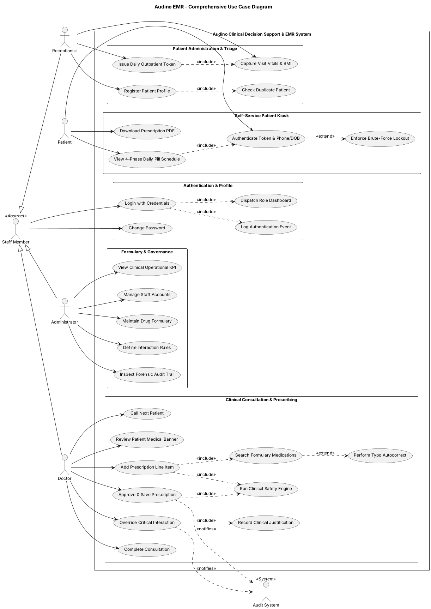
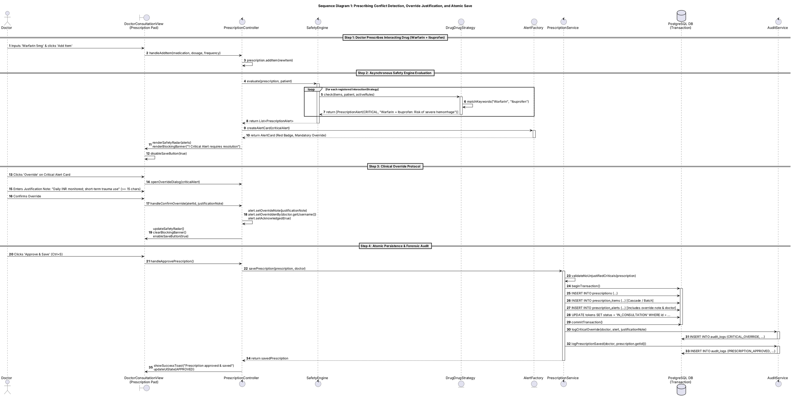
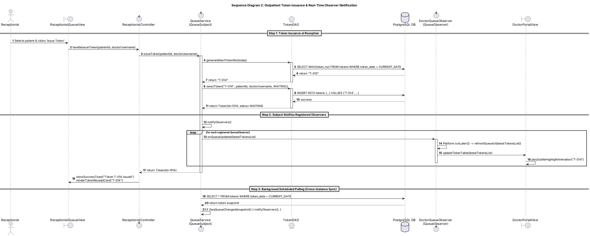
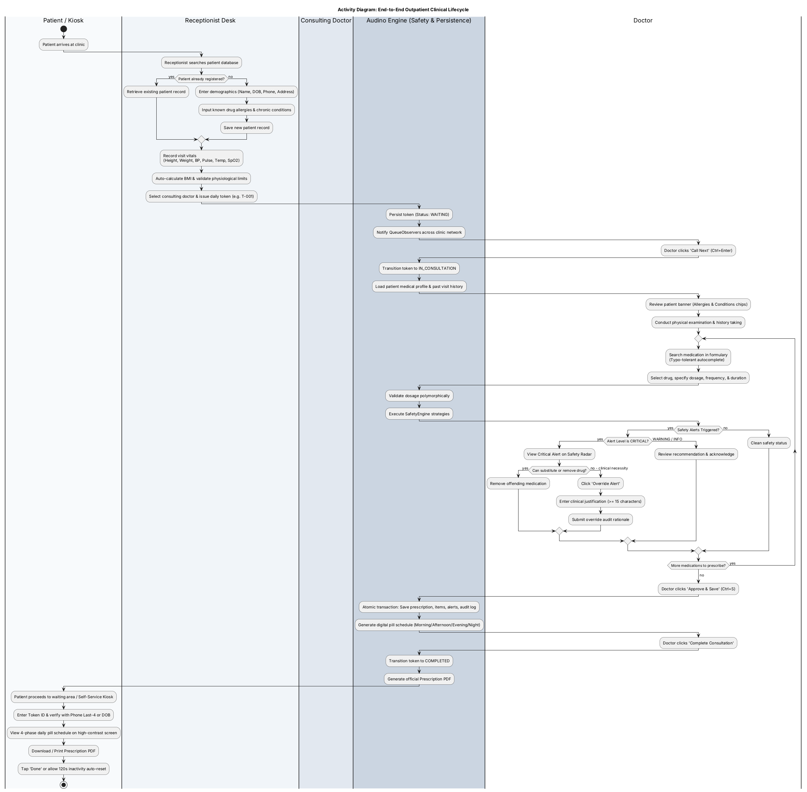
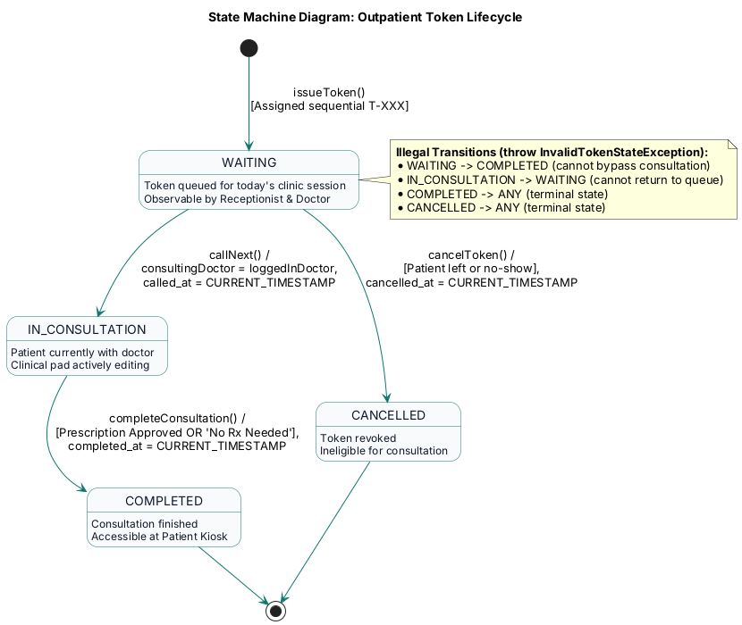
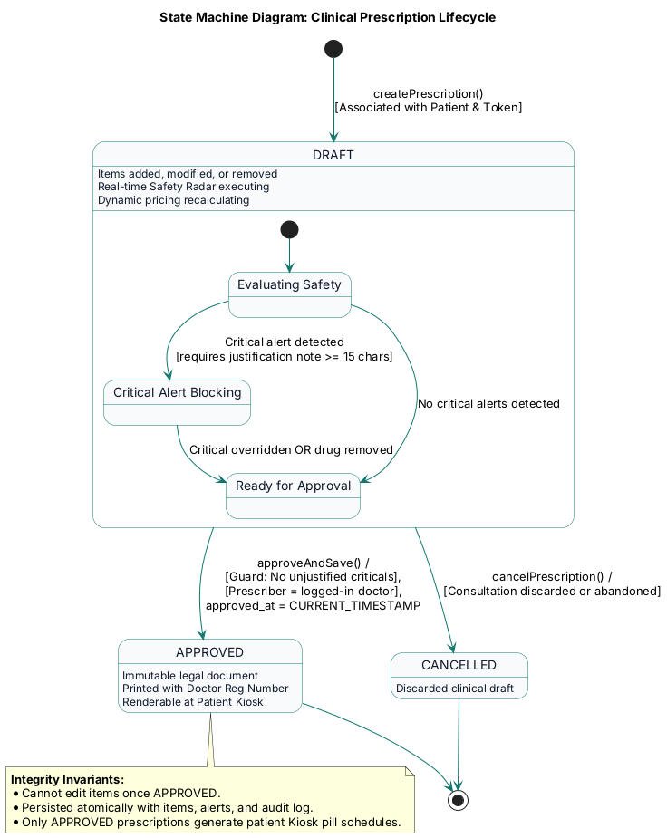

# UML Modeling & Architecture Diagrams
## Audino: Intelligent Clinical Decision Support & EMR System

**Document Version:** 1.0.0  
**Phase:** Requirements & Design Baseline (Phase 1)  
**Academic Modules:** Object-Oriented Methodology (OOM) & Software Engineering (SE)

---

## 1. Overview and Rendering Instructions

This document compiles the formal Unified Modeling Language (UML) structural, behavioral, and architectural models designed for **Audino**. The models adhere to the official UML 2.5 specification and are maintained as version-controlled `.puml` files in the [`docs/diagrams/`](file:///c:/Users/tabas/Downloads/clinicalprescriber/docs/diagrams/) directory.

### Rendering PlantUML Diagrams to High-Resolution PNG/SVG:
To compile the raw `.puml` source files into vector images:
1. **Via PlantUML CLI:**
   ```bash
   # Download plantuml.jar and graphviz (dot)
   java -jar plantuml.jar -tpng docs/diagrams/*.puml
   ```
2. **Via Visual Studio Code / JetBrains IDE:**
   Install the official **PlantUML** extension (`jebbs.plantuml`), open any `.puml` file, and press `Alt + D` to preview or right-click to export.
3. **Via Online Server:**
   Paste the PlantUML code directly into [PlantText](https://www.planttext.com/) or the official [PlantUML Web Server](http://www.plantuml.com/plantuml/).

---

## 2. Use Case Model

### 2.1 Use Case Diagram Description
The use case diagram illustrates the functional boundaries of the system across four human user classes (`Administrator`, `Doctor`, `Receptionist`, `Patient`) inheriting from an abstract `Staff Member` actor where appropriate, and one external `Audit System` actor. The diagram employs `<<include>>` and `<<extend>>` stereotyping to represent mandatory sub-routines (e.g., duplicate checking during registration, safety radar during prescription addition) and optional/conditional pathways (e.g., brute-force lockout during kiosk authentication, typo autocorrect).

### 2.2 PlantUML Specification


---

## 3. Structural Class Diagram (OOM Rubric Showcase)

### 3.1 Class Architecture & Relationships
The class diagram demonstrates rigorous object-oriented design principles:
1. **Inheritance & Abstraction Hierarchy 1 (`Account`):**
   - Abstract base `Account` encapsulates security identity (`username`, `passwordHash`, `role`, `active`).
   - Declares pure abstract methods: `getDashboardFxml()` and `getPermissions()`.
   - Subclasses: `Admin`, `Doctor` (adding clinical specialization and NMC registration number), and `Receptionist`.
2. **Inheritance & Abstraction Hierarchy 2 (`Medication`):**
   - Abstract base `Medication` encapsulates pharmacopeia metadata (`genericName`, `brandName`, `rxNormCode`, `strength`, `pricePerUnit`).
   - Declares pure polymorphic operations: `isValidDosage(String)`, `getUnitLabel()`, and `calculateUnits(dosage, timesPerDay, days)`.
   - Subclasses: `TabletMedication`, `CapsuleMedication`, `LiquidMedication` (dosed in ml), `InjectionMedication` (vials/ml).
3. **UML Multiplicities and Relationships:**
   - **Composition (`*--`):** `Prescription` strictly owns its `PrescriptionItem`s and `PrescriptionAlert`s. If a prescription draft is deleted, its items and alerts cease to exist. Similarly, `Patient` owns `PatientAllergy` and `PatientCondition`.
   - **Aggregation (`o--`):** `Prescription` aggregates `Medication` references. Medications exist independently in the clinic formulary and outlive any single prescription.
   - **Association (`--`):** `Doctor` associates with `Patient` through `Token` consultations and `Prescription.prescribedBy`.
4. **Design Pattern Integration:**
   - **Strategy:** `InteractionStrategy` interface with four concrete strategy implementations.
   - **Observer:** `QueueSubject` / `QueueObserver` for real-time queue broadcasting.
   - **DAO:** Interface-driven persistence abstraction with pure JDBC implementations.
   - **Factory:** `AccountFactory`, `MedicationFactory`, `AlertFactory`.
   - **Singleton:** `ConfigurationManager` (HikariCP pool) and `SessionManager`.

### 3.2 PlantUML Specification
See [`docs/diagrams/class_diagram.puml`](file:///c:/Users/tabas/Downloads/clinicalprescriber/docs/diagrams/class_diagram.puml) for the full source.

---

## 4. Behavioral Sequence Diagrams

### 4.1 Sequence Diagram 1: Prescribing Conflict Detection, Override Justification, and Atomic Save
This scenario models the critical clinical safety pathway:
1. A doctor enters `Warfarin 5mg` while `Ibuprofen` is already present on the prescription.
2. The `PrescriptionController` triggers the `SafetyEngine`.
3. The engine iterates over registered `InteractionStrategy` objects.
4. `DrugDrugStrategy` executes keyword matching against active database rules and flags a `CRITICAL` interaction.
5. The `AlertFactory` instantiates an alert UI model; the prescription pad disables the save button and renders a blocking top banner.
6. The doctor acknowledges the clinical necessity and provides a justification note exceeding the 15-character regulatory requirement.
7. Upon clicking `Approve & Save`, `PrescriptionService` validates the override note, opens an explicit JDBC transaction, writes the prescription header, items, alerts, updates token status, and writes an entry to `audit_logs`.



---

### 4.2 Sequence Diagram 2: Outpatient Token Issuance & Observer Notification
This scenario models real-time queue synchronization:
1. Receptionist captures vitals and issues token `T-014`.
2. `QueueService` acts as a `QueueSubject`.
3. It updates the database via `TokenDAO` and notifies all registered `QueueObserver` instances.
4. Each observer schedules its UI refresh on the JavaFX Application Thread via `Platform.runLater()`.
5. Background scheduled polling allows decoupled instances on other clinic machines to stay synchronized every 3 seconds.



---

## 5. Activity Diagram: Outpatient Clinical Lifecycle

The activity diagram models the end-to-end patient progression across 4 swimlanes: `Patient / Kiosk`, `Receptionist Desk`, `Consulting Doctor`, and `Audino Engine`.



---

## 6. State Machine Diagrams

### 6.1 Token Lifecycle State Machine


### 6.2 Prescription Lifecycle State Machine


---

## 7. Relational Database Entity-Relationship (ER) Diagram

See [`docs/diagrams/er_diagram.puml`](file:///c:/Users/tabas/Downloads/clinicalprescriber/docs/diagrams/er_diagram.puml) for the relational schema representing 12 core tables: `accounts`, `patients`, `patient_allergies`, `patient_conditions`, `patient_vitals`, `medications`, `medication_ingredients`, `interaction_rules`, `tokens`, `prescriptions`, `prescription_items`, `prescription_alerts`, and `audit_logs`.

---

## 8. Component & Deployment Architecture

See [`docs/diagrams/component_and_deployment_diagram.puml`](file:///c:/Users/tabas/Downloads/clinicalprescriber/docs/diagrams/component_and_deployment_diagram.puml) illustrating the multi-tiered JavaFX desktop application architecture, integration with the HikariCP connection pool, and the dual deployment model (External PostgreSQL port 5432 vs. Zero-Setup Embedded PostgreSQL).
