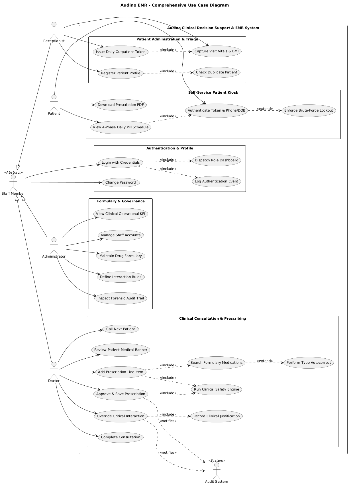
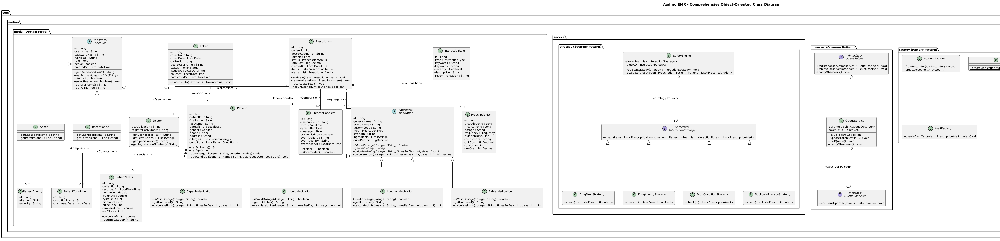
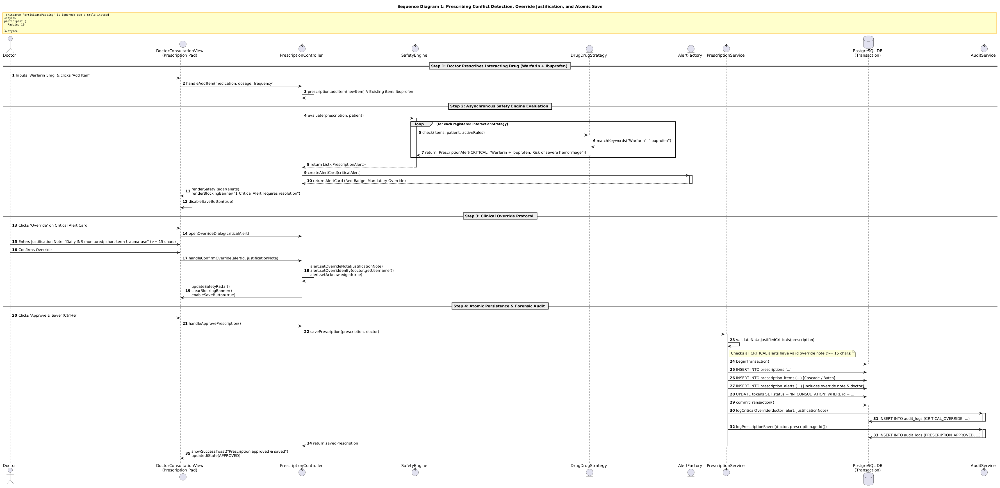
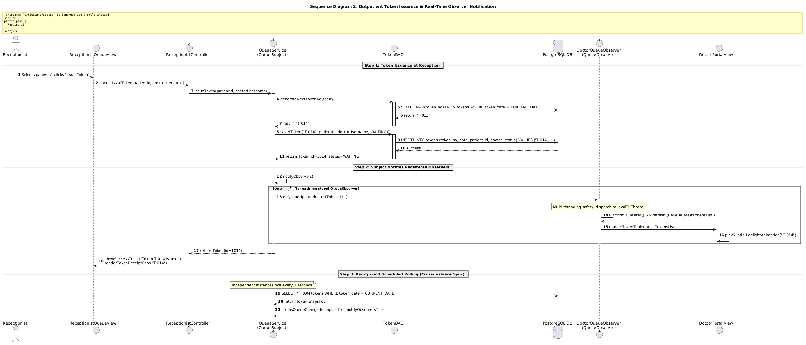
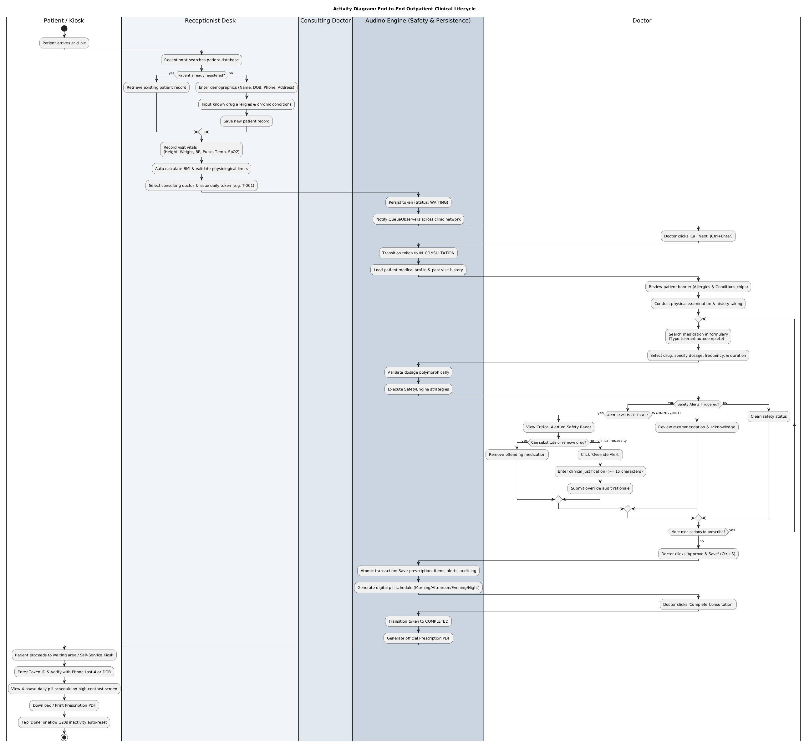
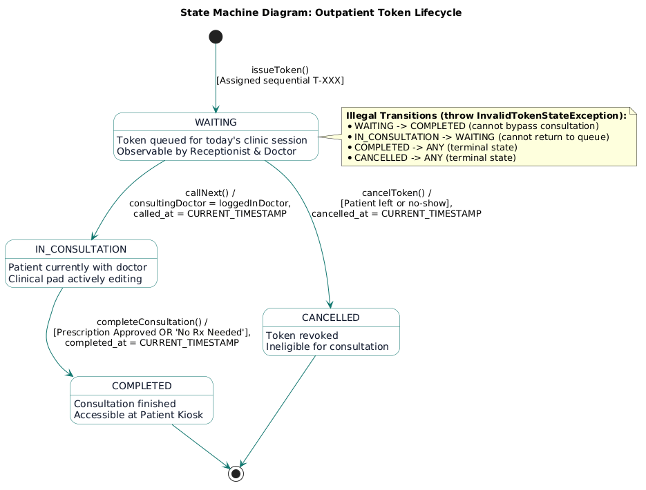
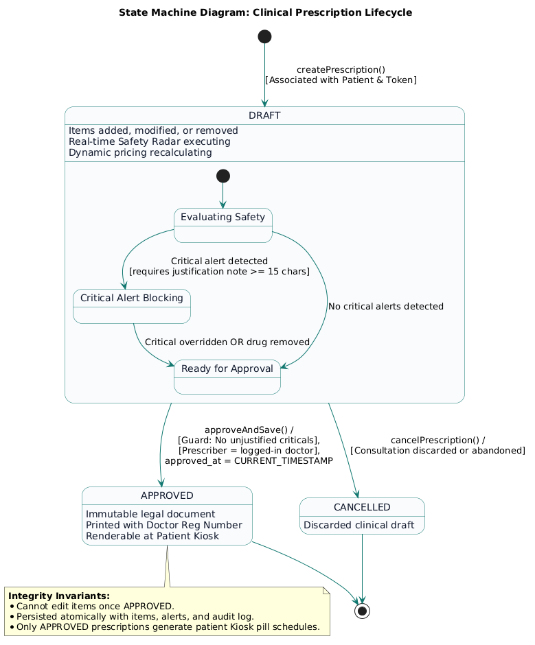
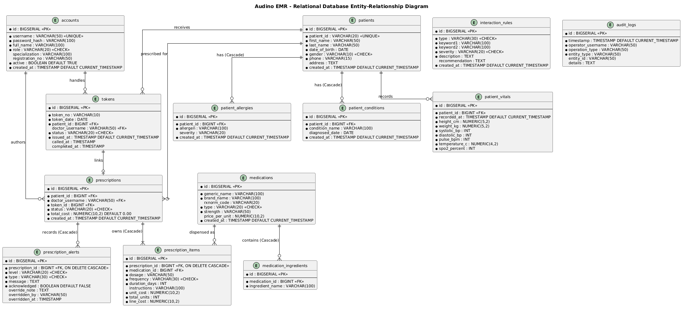
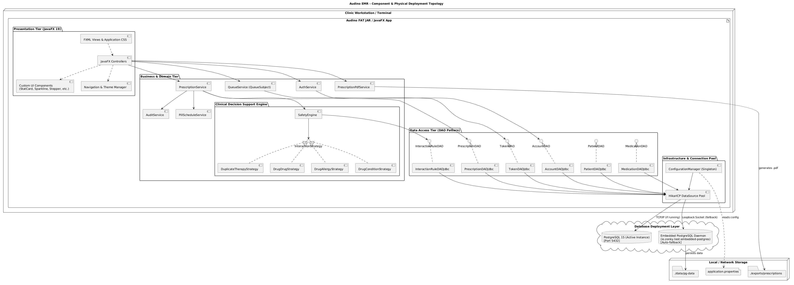

# UML Diagrams — Audino

## 1. Use Case Diagram

Shows the main actors and their interactions with the Audino system, including authentication, patient management, consultation, prescribing, kiosk access, and administration.

---

## 2. Class Diagram

Shows the main classes, inheritance, associations, composition, aggregation, and object-oriented design patterns used in Audino.

---

## 3. Sequence Diagram — Prescription Safety

Shows the flow of prescribing a medication, detecting a critical interaction, overriding the alert with justification, and saving the prescription.

---

## 4. Sequence Diagram — Queue Token Observer

Shows outpatient token generation, database storage, observer notification, and real-time queue updates.

---

## 5. Activity Diagram — Patient Lifecycle

Shows the complete outpatient workflow from patient registration and triage through consultation, prescription, safety checks, and kiosk access.

---

## 6. State Diagram — Token Lifecycle

Shows the lifecycle of a patient token from `WAITING` to `IN_CONSULTATION`, `COMPLETED`, or `CANCELLED`.

---

## 7. State Diagram — Prescription Lifecycle

Shows the prescription states from `DRAFT` through safety evaluation to `APPROVED` or `CANCELLED`.

---

## 8. ER Diagram

Shows the main database entities and their relationships in the Audino system.

---

## 9. Component & Deployment Diagram

Shows the major software components, database connectivity, and deployment architecture of Audino.

